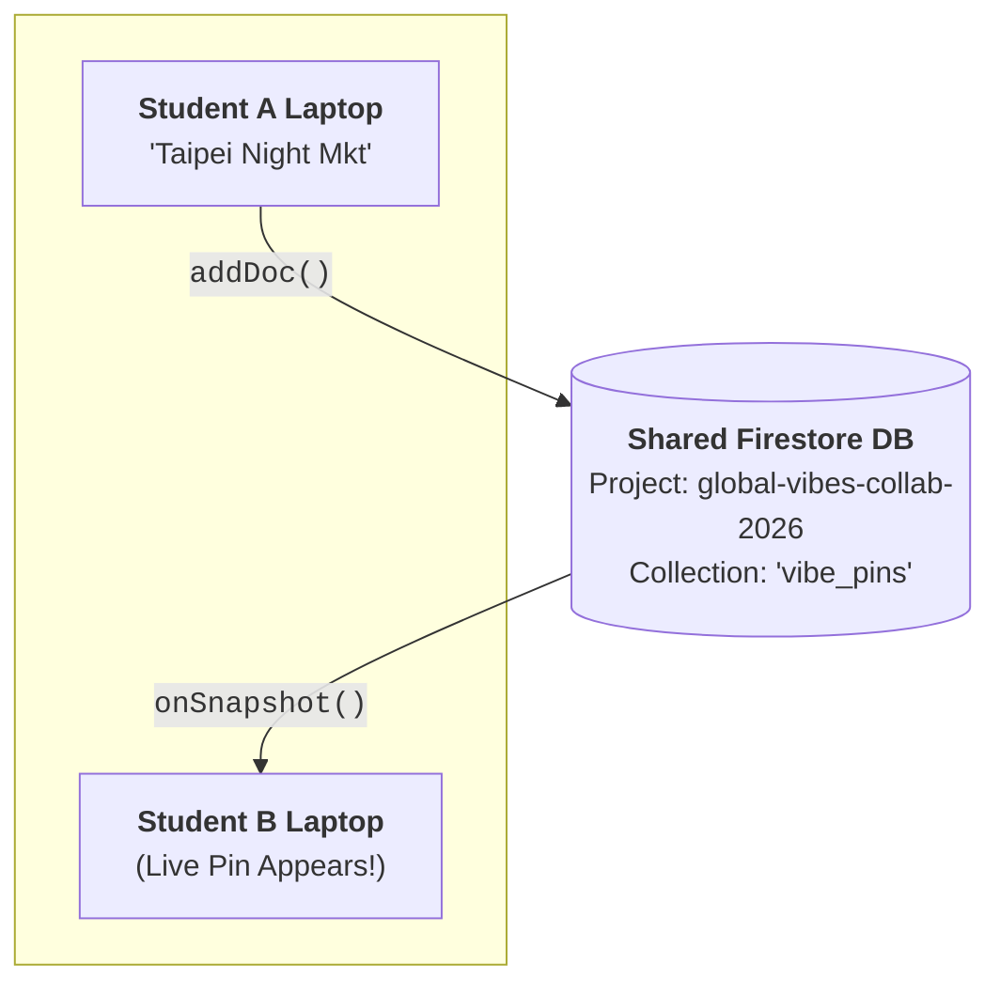

# In-Class Activity: The Global Street Vibe Atlas 🌐

## Overview

Welcome to the **Global Street Vibe Atlas**! This collaborative, in-class activity introduces **remote data persistence** using a **Backend-as-a-Service (Google Cloud Firestore)** in Vanilla JavaScript (no bundlers or frameworks...yet!).

Everyone connects to the **same live Firestore database** (`global-vibes-collab-2026`) simultaneously. As you search for places anywhere on Earth and log sensory vibe pins (or click `"✨ Feel This Vibe"`), observations appear and pulse across everyone's 3D globes in real time.



## Running the Apps Locally

You can run either application using any local static web server (such as Python's built-in HTTP server or the VS Code _Live Preview_ extension by right-clicking the `index.html` file and selecting **Show Preview**):

## Classroom Walkthrough

### Part 1 (00–15m): Exploring the 3D Globe, setting up your instance, and the limits of `localStorage`

1. **Spin the Globe:** Open `app/index.html`. Even without a Mapbox token, the app renders a 3D globe using MapLibre GL JS and OpenFreeMap vector tiles.
2. **Customize Your Instance:** Open `js/config.js`:
   - Change `instanceSettings.initialCenter` to your hometown or favorite city (e.g. `[121.5654, 25.0330]` for Taipei or `[-99.1332, 19.4326]` for Mexico City).
   - If you want to use Mapbox styles, enter your Mapbox public access token (in `config.js` or via the **⚙️ Settings** button in the header) and try changing `mapboxStyleId` to `'mapbox/dark-v11'` or `'mapbox/satellite-streets-v12'`. The `process_mapbox.js` module converts Mapbox vector tile styles to a format that can be used with MapLibre GL JS.
3. **The Limits of Local Storage:** Click anywhere on the map (or search for a city) and drop a vibe pin. Refresh your browser—your pin is still there because it's saved in `localStorage`. But look at your neighbor's screen or the classroom projector: **nobody else can see your pin!** Why? Because `localStorage` is trapped inside your browser's private sandbox.

### Part 2 (15–40m): Writing to Cloud Firestore with `addDoc()`

Open `app/js/backend.js`. Let's replace the `localStorage` save function with Cloud Firestore:

1. **Import Firebase from Google's CDN:**
   ```javascript
   import { initializeApp } from 'https://www.gstatic.com/firebasejs/12.5.0/firebase-app.js';
   import {
     getFirestore,
     collection,
     addDoc,
     getDocs,
     query,
     where,
     onSnapshot,
     doc,
     updateDoc,
     increment,
     serverTimestamp,
   } from 'https://www.gstatic.com/firebasejs/12.5.0/firebase-firestore.js';
   import { firebaseConfig } from './config.js';

   const app = initializeApp(firebaseConfig);
   const db = getFirestore(app);
   const COLLECTION_NAME = 'vibe_pins';
   ```

2. **Implement `savePin(pinData)`:** Update the function to write data to the shared database rather than into your local storage.
   ```javascript
   async savePin(pinData) {
     console.log('Writing pin to Cloud Firestore...', pinData);
     const collRef = collection(db, COLLECTION_NAME);
     const docRef = await addDoc(collRef, {
       ...pinData,
       submittedAt: serverTimestamp(),
     });

     const savedPin = { id: docRef.id, ...pinData };
     Backend.events.dispatchEvent(new CustomEvent('save-pin:success', {
       detail: { pin: savedPin },
     }));
     return savedPin;
   }
   ```

3. **Try It!** Search for a place anywhere in the world and submit a pin. Watch the instructor's screen as the Firebase Console populates with records!

---

### Part 3 (40–65m): Going Multiplayer with `onSnapshot()` ("`addEventListener` for Your Database")

Right now, our pins are safely stored in Google Cloud, but our map only loads pins from `localStorage`. Let's subscribe to real-time updates!

1. **Replace `loadPins()` with `subscribeToPins()`:**
   ```javascript
   subscribeToPins(filter = 'all') {
     if (typeof Backend.unsubscribeSnapshot === 'function') {
       Backend.unsubscribeSnapshot();
     }

     const collRef = collection(db, COLLECTION_NAME);

     // onSnapshot calls your callback immediately with current data,
     // and then pushes a new snapshot every time ANYONE in the room adds/edits a doc!
     Backend.unsubscribeSnapshot = onSnapshot(collRef, (snapshot) => {
       const pins = [];
       snapshot.forEach((docSnap) => {
         pins.push({ id: docSnap.id, ...docSnap.data() });
       });

       pins.sort((a, b) => new Date(b.submittedAt || 0) - new Date(a.submittedAt || 0));

       Backend.events.dispatchEvent(new CustomEvent('pins-updated', {
         detail: { pins },
       }));
     });
   }
   ```

2. **Connect It in `init()`:**
   In `Backend.init()`, replace `await Backend.loadPins()` with:
   ```javascript
   Backend.subscribeToPins(initialFilter);
   ```

3. **Shared Data ✨:** Look at your 3D globe; every pin logged by your classmates across the globe should appear simultaneously without refreshing!

4. **Stretch Goal: Live Endorsements (`+1 Feel This Vibe`):**
   ```javascript
   async endorsePin(pinId, delta = 1) {
     const pinRef = doc(db, COLLECTION_NAME, pinId);
     await updateDoc(pinRef, {
       endorsements: increment(delta),
     });
   }
   ```
   Click `"✨ Feel This Vibe"` on a classmate's pin and watch the count increment on everyone's screens in real time.

---

### Act 4 (65–90m): Server-Side Queries (`query` + `where`)

1. **Server-Side Filtering with `query()` and `where()`:**
   If there are 5,000 pins in our database, we shouldn't download all 5,000 pins over the network if the user is only interested in food markets.
   In `subscribeToPins(filter)`:
   ```javascript
   let targetQuery = collRef;
   if (filter && filter !== 'all') {
     targetQuery = query(collRef, where('vibeCategory', '==', filter));
   }

   Backend.unsubscribeSnapshot = onSnapshot(targetQuery, (snapshot) => { ... });
   ```
   Now Google Cloud does the filtering on its servers before sending data across the wire!

<!--
2. **Connecting to Project 3: Inviting Participation:**
   Look at how our app answers the **5 Guiding Statements** from `INSTRUCTIONS.md`:
   - **Participants:** Urban explorers and travelers with on-the-ground knowledge of street corners.
   - **Invited Input:** Sensory observations (dominant vibe, energy rating, smell/sound description).
   - **Participant Benefit:** Shared discovery of hidden sanctuaries, street food, and music hubs worldwide.
-->

## Reference Files in This Example

- `app/`: Starter code (uses `localStorage` in `js/backend.js`).
- `app_final/`: Solution reference code (uses Cloud Firestore `addDoc`, `onSnapshot`, `query`/`where`, and `updateDoc`).
- `js/process_mapbox.js`: Safe Mapbox-to-MapLibre converter using your Mapbox token.
- `js/config.js`: Per-student `instanceSettings` and shared `firebaseConfig`.

